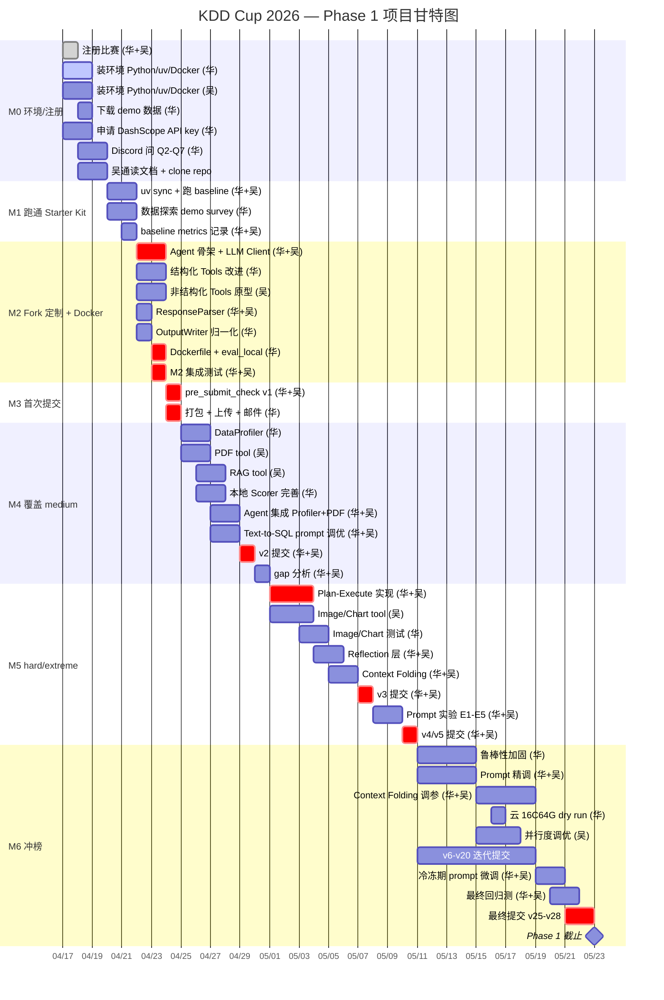
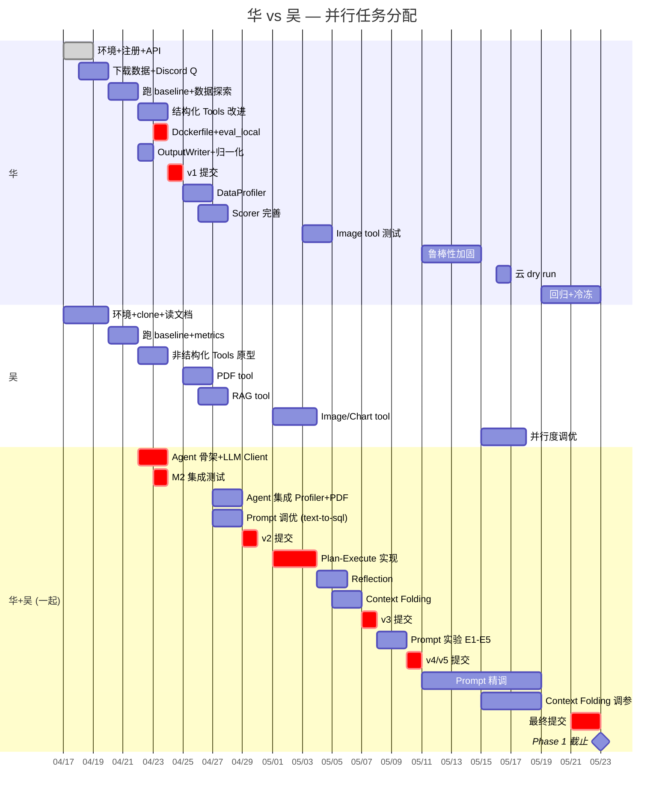
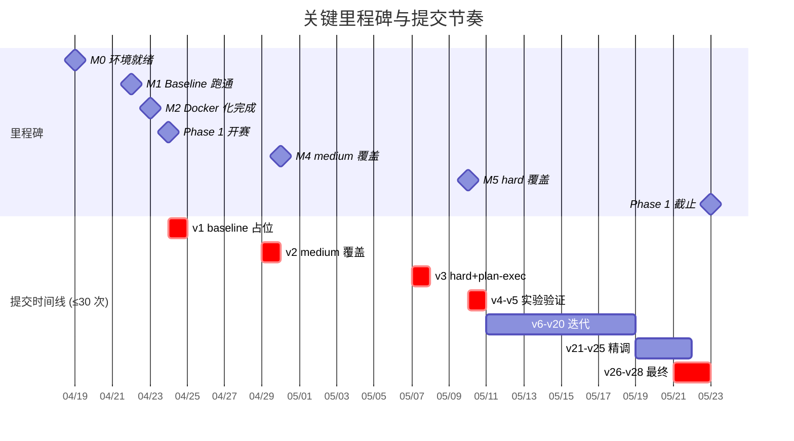

# 13. Gantt 图（项目甘特图）

> GitHub 原生渲染 Mermaid。若本地不渲染，用 [mermaid.live](https://mermaid.live) 粘贴查看。

## 13.1 总览 Gantt（M0 → M6）

## 13.2 两人并行视图

## 13.3 关键里程碑

## 13.4 注意事项

- `crit` 标记 = 关键路径上的任务，延迟会影响后续所有里程碑
- `done` = 已完成（注册 ✅）
- `active` = 进行中
- **华+吴 一起做的任务**集中在 Agent 核心循环、Plan-Execute、Reflection、Prompt 调优——这些需要两人对齐设计思路，不宜各写各的
- 甘特图的日期是**目标日期**，实际可能偏移 1-2 天；每周日复盘时校准
